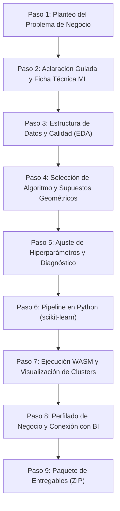

# PLAN: Asistente Pedagógico de Ciencia de Datos y Machine Learning (Web Estática, BYOK)

> **Destinatario:** Documento maestro para instruir a un agente de código (Antigravity, Claude Code, etc.) en la creación del nuevo proyecto.
> **Regla de desarrollo para el agente:** Implementar **fase por fase**, en orden estricto. Al terminar cada fase: correr tests, verificar compilación limpia (`npm test` y `npm run build`), indicar al usuario cómo probarla y **esperar confirmación explícita** antes de continuar. No agregar funcionalidades fuera de este documento.

---

## 1. Objetivo y Filosofía Pedagógica

Construir una aplicación web **100% estática, sin backend (modelo BYOK - Bring Your Own Key)** para estudiantes que se inician en **Ciencia de Datos e Inteligencia Artificial**, basada en el diseño curricular y materiales de la cátedra (*Centro Educativo Paulo Freire — U.E.G.P. N° 165*):
- Diferenciación entre Inteligencia de Negocios (BI) y Análisis Predictivo (AP / ML).
- Formulación de problemas de negocio y elaboración de la **Ficha Técnica de Machine Learning** (paradigma de aprendizaje, tipo de tarea, variables predictoras $X$ y objetivo $Y$).
- Análisis exploratorio (EDA), limpieza y preprocesamiento de datos (escalado, codificación, calidad de datos).
- Aprendizaje no supervisado en profundidad: **K-Means**, **Clustering Jerárquico** y **DBSCAN**, comparación de supuestos geométricos y sensibilidad al ruido/outliers.
- Ajuste e interpretación de hiperparámetros (Método del Codo / Inercia WCSS, Coeficiente de Silueta, Dendrogramas, `eps` y `min_samples`).
- Interpretación de negocio de los agrupamientos (perfilado de clusters) y puente hacia la toma de decisiones / BI.
- Generación de código Python reproducible (`scikit-learn`, `pandas`, `matplotlib`, `scipy`) y ejecución real en el navegador mediante **Pyodide** (WebAssembly).
- **Paquete de entregables descargable** en ZIP (Jupyter Notebook `.ipynb`, script `.py`, dataset `.csv`, gráficos `.png`/`.svg`, reporte PDF/MD y glosario conceptual).

**Principio rector innegociable:** La IA es un **tutor socrático**, no un generador ciego de código. El estudiante dialoga, analiza opciones y confirma cada decisión técnica y metodológica. Si el planteo inicial es ambiguo, la IA formula preguntas aclaratorias guiadas antes de sugerir cualquier modelo o pipeline.

---

## 2. Arquitectura y Stack Tecnológico

| Componente | Decisión Tecnológica | Justificación |
|---|---|---|
| **Arquitectura** | **100% estática, sin backend** | Despliegue seguro y gratuito en Vercel, Netlify o GitHub Pages. Costo cero de infraestructura de servidor. |
| **Framework & Lenguaje** | **Vite + React 18/19 + TypeScript** | Build ultrarrápido, tipado estricto, modularidad y mantenimiento idéntico a DB Tutor. |
| **IA & SDK** | **`@google/genai` (SDK oficial) en el navegador** | Llamadas directas al endpoint de Gemini con la clave del estudiante. La clave nunca toca servidores intermedios. |
| **Validación de Datos** | **Zod** | Contrato estricto para todas las salidas JSON de Gemini, importaciones de archivos y estados internos. |
| **Salidas de la IA** | **Structured Outputs (JSON Schema)** | Respuestas estructuradas y predecibles; separación estricta entre datos formales y explicaciones didácticas. |
| **Ejecución de Python** | **Pyodide (WASM en Web Worker)** | Ejecución real de Python con `numpy`, `pandas` y `scikit-learn` directamente en el navegador del estudiante, sin servidores. |
| **Visualización Gráfica** | **SVG nativo interactivo / Canvas / Chart.js empaquetado** | Gráficos de dispersión (clusters), curvas del codo, silueta y dendrogramas sin dependencias CDN ni llamadas a terceros. |
| **Persistencia Local** | **IndexedDB (`idb`) + importación/exportación JSON** | Guardado de progreso y proyectos en el navegador del estudiante sin base de datos en la nube. |
| **Generación de Notebooks** | **Estructura nativa `.ipynb` (JSON format v4)** | Notebooks listos para abrir y ejecutar sin fricción en Google Colab, JupyterLab o VS Code. |
| **Compresión & ZIP** | **`fflate`** | Empaquetado binario cliente ultrarrápido con auditoría estricta de exclusión de API keys. |
| **Generación de PDF** | **`jspdf`** | Creación local del informe técnico de 1-2 páginas con soporte de fuentes UTF-8. |
| **Pruebas Automatizadas** | **Vitest + React Testing Library** | Pruebas unitarias de seguridad, parsers, validadores determinísticos y componentes con IA mockeada. |
| **Modelo de Gemini** | **Configurable en constante única** | Inicialmente `gemini-2.5-flash` o el modelo vigente recomendado por Google. |

---

## 3. Seguridad y Privacidad (Reglas de Primer Orden)

El proyecto debe implementar exactamente el mismo estándar riguroso de seguridad aplicado en el tutor de bases de datos:

### 3.1 Manejo de la API Key (BYOK)
1. **Aislamiento absoluto:** La clave se almacena **exclusivamente en `sessionStorage`** y es gestionada por un único módulo (`src/core/key.ts`).
2. **Prohibiciones estrictas:** Prohibido el uso de `localStorage`, IndexedDB, cookies, URLs, console logs o campos exportables para la API key.
3. **Onboarding obligatorio:** Pantalla inicial con advertencia legal y de privacidad visible (no descartable la primera vez):
   - La clave vive solo en la pestaña actual y se borra al cerrarla.
   - Recomendación de crear una clave específica en Google AI Studio y eliminarla al finalizar la cursada.
   - Recordatorio de no ingresar datos confidenciales o personales reales.
4. **Enmascaramiento y purga:** La UI enmascara la clave (`AIzaSy...****`) y ofrece un botón destacado "Olvidar API key ahora".
5. **Auditoría de exportación:** Antes de generar cualquier ZIP o archivo descargable, un escáner en memoria inspecciona cada byte buscando patrones de claves de Gemini (`AIza[0-9A-Za-z-_]{35}`) y aborta la descarga si detecta coincidencias.

### 3.2 Content-Security-Policy (CSP) Estricta y Anti-XSS
1. **Políticas CSP:** Declaradas en `vercel.json` y `public/_headers`:
   ```http
   default-src 'self';
   script-src 'self' 'wasm-unsafe-eval';
   style-src 'self' 'unsafe-inline';
   connect-src 'self' https://generativelanguage.googleapis.com https://cdn.jsdelivr.net;
   img-src 'self' data: blob:;
   object-src 'none';
   base-uri 'self';
   frame-ancestors 'none';
   ```
   *(Nota: `connect-src` a CDN de Pyodide solo si se cargan paquetes dinámicos WASM; de lo contrario, auto-hospedado en `public/pyodide/`).*
2. **Cero scripts externos:** Prohibidos tags `<script>` externos, trackers de analíticas o fuentes no empaquetadas.
3. **Prohibición de `dangerouslySetInnerHTML`:** Las respuestas de la IA se renderizan mediante componentes React seguros o parsers de Markdown sanitizados (`DOMPurify`).
4. **Protección anti-inyección de fórmulas en CSV:** Toda celda exportada que comience con `=`, `+`, `-`, `@`, tabulación o retorno se escapa anteponiendo `'`.

---

## 4. Flujo Pedagógico del Estudiante (Wizard de 8 Pasos)

Cada paso del asistente sigue la misma estructura pedagógica:
1. **Propósito claro del paso.**
2. **Caja conceptual pedagógica colapsable** (`<details className="concept-box">`) explicando el fundamento teórico según los apuntes de la cátedra.
3. **Interacción y sugerencia del Tutor IA.**
4. **Confirmación y toma de decisión del estudiante** (quien tiene la última palabra).



### Paso 1: Planteo del Problema de Negocio
- **Qué hace el estudiante:** Describe en lenguaje cotidiano qué reto comercial, industrial o analítico necesita resolver (ej. *"Tengo un e-commerce y quiero identificar grupos de clientes según frecuencia de compra y ticket promedio para fidelizarlos"* o *"Una fábrica automotriz quiere programar un vehículo para estacionarse solo"*).
- **Presets pedagógicos incluidos:**
  1. *Segmentación de clientes retail/e-commerce* (Clases 13 y 14 - K-Means).
  2. *Detección de formas geométricas no lineales / anomalías en sensores* (Clase 15 - DBSCAN / Lunas).
  3. *Agrupamiento taxonómico jerárquico de productos* (Clase 15 - Jerárquico).
  4. *Dashboard de ventas y facturación histórica* (Guía Power BI vs Análisis Predictivo).

### Paso 2: Aclaración Guiada y Ficha Técnica de ML
- **Concepto didáctico:** Diferencia entre Inteligencia de Negocios (BI: descriptivo, qué pasó) y Aprendizaje Automático (ML: patrones predictivos/descubrimiento); Taxonomía del aprendizaje (Supervisado vs. No Supervisado vs. Por Refuerzo); Distinción de variables predictoras ($X$ / Features) y variable objetivo ($Y$ / Target).
- **Interacción del Tutor:**
  - Evalúa la claridad mediante `evaluarClaridadProblemaDS`.
  - Si faltan datos, formula 3 a 5 preguntas concretas socráticas (máximo 3 rondas).
  - Produce la **Ficha Técnica de Machine Learning**:
    - Paradigma: `supervisado` | `no_supervisado` | `refuerzo`.
    - Tipo de tarea: `clustering` | `clasificacion` | `regresion` | `bi_descriptivo`.
    - Features ($X$) identificadas y Target ($Y$) si aplica.
    - Justificación metodológica.

### Paso 3: Estructura de Datos y Calidad (EDA y Preprocesamiento)
- **Concepto didáctico:** Tipos de variables (numérica continua, discreta, categórica nominal/ordinal); Tratamiento de valores faltantes (imputación vs. eliminación); Detección de errores e inconsistencias (como se enseña en Power Query); **Escalado de características** (`StandardScaler` vs `MinMaxScaler` y por qué K-Means sufre con magnitudes dispares por el cálculo de distancia euclidiana).
- **Interacción del Tutor:** Tabla interactiva de variables donde el estudiante revisa tipos, unidades, rango esperado y método de escalado recomendado. El estudiante confirma el esquema del dataset.

### Paso 4: Selección de Algoritmo y Supuestos Geométricos
- **Concepto didáctico:** Comparativa entre los 3 grandes métodos de Clustering de la cátedra:
  - **K-Means:** Rápido, escalable, pero asume clusters esféricos de densidad similar y es muy sensible a outliers.
  - **Clustering Jerárquico (Aglomerativo):** No requiere definir $K$ al inicio, genera dendrograma intuitivo, explora relaciones jerárquicas; computacionalmente costoso para grandes volúmenes.
  - **DBSCAN:** Basado en densidad, descubre formas geométricas arbitrarias (lunas, anillos), detecta ruido y outliers automáticamente; requiere ajustar `eps` y `min_samples`.
- **Interacción del Tutor:** El estudiante evalúa los supuestos de sus datos guiado por el tutor. Un validador determinístico emite advertencias (ej. *"Estás eligiendo K-Means pero mencionaste presencia fuerte de anomalías o formas no convexas; evaluá DBSCAN"*).

### Paso 5: Ajuste de Hiperparámetros y Diagnóstico
- **Concepto didáctico:**
  - En K-Means: **Inercia intra-cluster (WCSS)**, **Método del Codo (Elbow Method)** y **Coeficiente de Silueta** (rango de -1 a 1, interpretación de cohesión y separación).
  - En Jerárquico: Criterios de enlace (**Ward**, **Complete**, **Average**, **Single**) y corte del dendrograma.
  - En DBSCAN: Distancia de vecindad **`eps`** y mínimo de puntos **`min_samples`**.
- **Interacción del Tutor:** Visualizador interactivo de diagnóstico (curva del codo calculada o simulada, puntajes de silueta). El estudiante selecciona y fundamenta el número de clusters $K$ o los hiperparámetros elegidos.

### Paso 6: Pipeline de Código en Python (scikit-learn)
- **Concepto didáctico:** Buenas prácticas en código de ciencia de datos: importación limpia, separación de $X$, uso de `StandardScaler`, instanciación del estimador con `random_state` fijo para reproducibilidad, y cálculo de métricas de calidad.
- **Interacción del Tutor:** Código Python estructurado generado de forma determinística en módulos limpios, con un **modo "Explicar línea por línea"** del tutor IA que desglosa el rol de cada función de `scikit-learn` y `pandas`.

### Paso 7: Ejecución WASM y Visualización de Clusters
- **Concepto didáctico:** Interpretación visual de agrupamientos y proyecciones 2D (Scatter plot, centroides, puntos clasificados como ruido con etiqueta `-1`).
- **Interacción del Tutor:** Ejecución real en el navegador mediante **Pyodide** (WASM) en un Web Worker. Visualización de los datos sintéticos generados:
  - Gráfico interactivo de dispersión (SVG nativo responsive).
  - Centroides resaltados.
  - Puntos coloreados por cluster.
  - Tabla de métricas reales (Inercia calculada, Coeficiente de Silueta promedio).

### Paso 8: Perfilado de Negocio y Conexión con BI
- **Concepto didáctico:** Cerrar el ciclo de la Ciencia de Datos: traducir etiquetas numéricas (`Cluster 0`, `Cluster 1`, `Cluster 2`) en **insights accionables de negocio** (perfiles: *"Clientes Ocasionales de Ticket Alto"*, *"Compradores Recurrentes de Bajo Gasto"*). Conexión con Business Intelligence: cómo llevar estas etiquetas a Power BI para armar tableros de control con KPIs y tarjetas de facturación.
- **Interacción del Tutor:** El tutor ayuda a redactar la síntesis ejecutiva para el tomador de decisiones.

---

## 5. Esquemas de Datos (Zod) — Contrato de la IA y Estado

Los esquemas en `src/core/schemas.ts` gobiernan toda la aplicación:

```ts
import { z } from 'zod';

// Tipos de datos para variables
export const TipoVariableSchema = z.enum([
  'numerica_continua',
  'numerica_discreta',
  'categorica_nominal',
  'categorica_ordinal',
  'fecha_hora',
  'texto_libre'
]);

// Variable individual
export const VariableSchema = z.object({
  nombre: z.string().min(1),
  tipo: TipoVariableSchema,
  descripcion: z.string(),
  rol: z.enum(['feature', 'target', 'identificador']),
  escaladoRecomendado: z.enum(['ninguno', 'standard_scaler', 'min_max_scaler', 'robust_scaler']),
  justificacion: z.string()
});

// Paradigma y Tarea
export const ParadigmaMLSchema = z.enum(['supervisado', 'no_supervisado', 'refuerzo', 'bi_descriptivo']);
export const TareaMLSchema = z.enum(['clustering', 'clasificacion', 'regresion', 'dashboard_kpis']);

// Ficha Técnica
export const FichaTecnicaSchema = z.object({
  problemaNegocio: z.string(),
  paradigma: ParadigmaMLSchema,
  tarea: TareaMLSchema,
  justificacionParadigma: z.string(),
  variables: z.array(VariableSchema),
  variableTarget: z.string().optional(),
  restricciones: z.array(z.string())
});

// Aclaración guiada
export const AclaracionDSSchema = z.object({
  suficiente: z.boolean(),
  preguntas: z.array(z.string()).max(5),
  supuestosAConfirmar: z.array(z.string())
});

// Algoritmos soportados
export const AlgoritmoClusteringSchema = z.enum(['kmeans', 'jerarquico', 'dbscan']);

export const HiperparametrosClusteringSchema = z.object({
  algoritmo: AlgoritmoClusteringSchema,
  k: z.number().int().min(2).max(10).optional(),
  criterioEnlace: z.enum(['ward', 'complete', 'average', 'single']).optional(),
  eps: z.number().positive().optional(),
  minSamples: z.number().int().min(2).optional(),
  randomState: z.number().int().default(42),
  justificacionEstudiante: z.string()
});

// Diagnóstico / Métricas
export const MetricasEvaluacionSchema = z.object({
  inercia: z.number().optional(),
  silhouetteScore: z.number().min(-1).max(1),
  numeroClustersIdentificados: z.number().int(),
  porcentajeRuido: z.number().min(0).max(100).optional()
});

// Perfilado de Cluster para Negocio
export const PerfilClusterSchema = z.object({
  clusterId: z.union([z.number(), z.string()]),
  nombreDescriptivo: z.string(),
  caracteristicasClave: z.array(z.string()),
  tamanoRelativoPct: z.number(),
  accionDeNegocioRecomendada: z.string()
});

// Bitácora de Decisiones
export const DecisionDSSchema = z.object({
  paso: z.number(),
  fecha: z.string(),
  descripcion: z.string(),
  origen: z.enum(['estudiante', 'ia_aceptada', 'ia_rechazada'])
});

// Modelo de Proyecto Completo
export const ProyectoDSSchema = z.object({
  version: z.literal(1),
  fechaCreacion: z.string(),
  problemaOriginal: z.string(),
  fichaTecnica: FichaTecnicaSchema,
  hiperparametros: HiperparametrosClusteringSchema.optional(),
  metricas: MetricasEvaluacionSchema.optional(),
  perfiles: z.array(PerfilClusterSchema).optional(),
  bitacoraDecisiones: z.array(DecisionDSSchema)
});
```

---

## 6. Validador Determinístico de Ciencia de Datos (`modelValidatorDS.ts`)

Reglas lógicas determinísticas que alertan al estudiante antes de ejecutar:
1. **Regla de Escala en K-Means:** Si se usa K-Means con variables de diferentes órdenes de magnitud (ej. *Edad: 20-80* vs *Facturación: 10.000-5.000.000*) y no se activó `StandardScaler`, generar advertencia pedagógica crítica sobre distorsión de la distancia euclidiana.
2. **Regla de Formas No Convexas:** Si la descripción menciona estructuras complejas, lunas o anillos concéntricos, advertir que K-Means asumirá particiones hiper-esféricas y recomendar DBSCAN o Jerárquico.
3. **Regla de Outliers / Ruido:** Si se reportan anomalías severas y se elige K-Means, alertar sobre el desplazamiento indeseado de centroides y sugerir DBSCAN (`eps`, `min_samples`).
4. **Regla de Features Insuficientes:** No permitir clustering con menos de 2 variables cuantitativas o explicativas.
5. **Regla de Dimensionalidad Excesiva:** Si hay más de 10 variables, advertir sobre la "maldición de la dimensionalidad" para distancias euclidianas.

---

## 7. Paquete de Entregables Descargables (ZIP Seguro)

El botón final genera en memoria un archivo ZIP con:

| Archivo en ZIP | Formato | Contenido |
|---|---|---|
| `proyecto_ds.json` | JSON | Estado completo para reanudar la sesión en la app. **Sin API key**. |
| `notebook_clustering.ipynb` | JSON v4 (`.ipynb`) | Jupyter Notebook completamente formateado y ejecutable en Google Colab con celdas de Markdown y código. |
| `pipeline_sklearn.py` | Python (`.py`) | Script modular estructurado con preprocesamiento, modelo y métricas. |
| `dataset_ejemplo.csv` | CSV seguro | Datos sintéticos coherentes con encabezados limpios y protección anti-fórmulas (`'`). |
| `ficha_tecnica.md` | Markdown | Ficha Técnica detallada con variables, target, supuestos y justificación. |
| `reporte_ejecutivo.pdf` | PDF (1-2 pág) | Síntesis ejecutiva: problema, algoritmo elegido, silueta obtenida, perfiles de clusters y valor de negocio. |
| `grafico_clusters.svg` / `.png` | SVG / PNG | Gráfico de dispersión generado y exportado en alta resolución. |
| `curva_codo_silueta.svg` | SVG | Gráfico de diagnóstico del método del codo y silueta. |
| `glosario_ciencia_datos.md` | Markdown | Glosario exclusivo de los términos técnicos aparecidos en la sesión. |

---

## 8. Design System y Experiencia de Usuario

Para garantizar la misma calidad visual homogénea que el proyecto de bases de datos:
1. **Contenedor raíz del paso:** `<section className="card studio-step-card" aria-labelledby="stepX-title" data-testid="stepX-container">`.
2. **Encabezado unificado:** `<div className="step-header"><span className="step-badge">Paso X de 8</span><div><h2 id="stepX-title" className="card-title">...</h2><p className="step-lead">...</p></div></div>`.
3. **Caja conceptual pedagógica:** `<details className="concept-box" data-testid="stepX-concept-box"><summary className="concept-summary">💡 Fundamento teórico: ...</summary><div className="concept-content">...</div></details>`.
4. **Bloque de explicación del tutor IA:** `<div className="tutor-explanation-box"><strong>Tutor IA:</strong><p>...</p></div>`.
5. **Barra de herramientas y controles:** `<div className="toolbar-row">...</div>`.
6. **Navegación inferior estándar:** `<div className="button-group"><button className="btn btn-secondary">← Volver...</button><button className="btn btn-primary">Confirmar y Avanzar...</button></div>`.
7. **Modo Claro / Modo Oscuro** integrado con variables CSS consistentes.
8. **Accesibilidad completa:** Navegación por teclado, skip links y atributos ARIA.

---

## 9. Fases de Implementación para el Agente

El desarrollo debe realizarse de manera rigurosamente incremental:

### Fase 0: Andamiaje, Seguridad y Onboarding BYOK
- Inicialización de proyecto Vite + React + TypeScript.
- Configuración de cabeceras CSP en `vercel.json` y `public/_headers`.
- Módulo `src/core/key.ts` (manejo exclusivo de `sessionStorage`, validación y purge).
- Wrapper `src/core/gemini.ts` con manejo de errores, reintentos y modelo configurable.
- Pantalla de Onboarding no ocultable la primera vez con advertencia legal y de privacidad.
- Enmascarado de key y botón "Olvidar API key".
- *Criterio de aceptación:* Suite de tests en `tests/fase0.test.tsx` verificando que la key no se filtre a `localStorage`, IndexedDB ni URLs, y build limpio.

### Fase 1: Núcleo Conceptual y Ficha Técnica de ML
- Prompt versionado `src/prompts/system_tutor_ds.md`.
- Esquemas Zod en `src/core/schemas.ts`.
- Módulo `evaluarClaridadProblemaDS` y generador de Ficha Técnica (`src/core/clarityDS.ts`).
- Componentes de Pasos 1 y 2 (`Step1ProblemaDS.tsx`, `Step2FichaTecnicaDS.tsx`).
- Persistencia en IndexedDB (`src/core/storageDS.ts`) y registro de bitácora de decisiones.
- 4 Presets didácticos listos para cargar.
- *Criterio de aceptación:* Tests en `tests/fase1.test.tsx` garantizando que el flujo socrático repregunte ante ambigüedad y no avance sin confirmación.

### Fase 2: EDA, Variables y Validador Determinístico
- Componentes de Paso 3 (`Step3EstructuraDatosDS.tsx`) y Paso 4 (`Step4SeleccionAlgoritmoDS.tsx`).
- Validador determinístico `src/core/modelValidatorDS.ts` con las 5 reglas pedagógicas.
- Fallback deductivo local cuando no hay conexión a la IA.
- *Criterio de aceptación:* Tests unitarios en `tests/fase2.test.tsx` cubriendo cada regla del validador y su resolución rápida.

### Fase 3: Diagnóstico de Hiperparámetros (Codo y Silueta)
- Componente de Paso 5 (`Step5HiperparametrosDS.tsx`).
- Motor determinístico de cálculo/simulación de Inercia WCSS y Coeficiente de Silueta (`src/core/metrics/diagnostics.ts`).
- Renderizador visual interactivo de la Curva del Codo y Gráfico de Silueta en SVG puro sanitizado.
- Justificación pedagógica guiada del tutor.
- *Criterio de aceptación:* Tests en `tests/fase3.test.tsx` validando rangos matemáticos y renderizado SVG.

### Fase 4: Generador de Pipelines y Código Python
- Módulo de generación de código `scikit-learn` en `src/core/python/pipelineGenerator.ts`.
- Generación de scripts limpios `.py` y estructura estándar de Jupyter Notebook `.ipynb` (JSON format v4 con celdas de markdown explicativas y código).
- Componente de Paso 6 (`Step6PipelinePythonDS.tsx`) con modo de explicación interactiva línea por línea del tutor IA.
- *Criterio de aceptación:* Tests en `tests/fase4.test.tsx` verificando sintaxis válida de Python y estructura de celdas JSON de `.ipynb`.

### Fase 5: Ejecución WASM con Pyodide en Web Worker
- Web Worker aislado `src/core/workers/pyodideWorker.ts` y cliente `src/core/workers/pyodideClient.ts`.
- Carga de Pyodide WASM con `numpy`, `pandas` y `scikit-learn`.
- Generador de dataset sintético coherente con las variables definidas (`src/core/sampleDataset.ts`).
- Ejecución real del pipeline en el worker con timeout de seguridad.
- Componente de Paso 7 (`Step7EjecucionWasmDS.tsx`) con visualización interactiva de clusters en 2D (SVG nativo).
- *Criterio de aceptación:* Tests en `tests/fase5.test.tsx` ejecutando un pipeline de K-Means o fallback mockeado en worker.

### Fase 6: Perfilado de Negocio y Puente con BI
- Componente de Paso 8 (`Step8PerfiladoBIDS.tsx`).
- Traducción guiada de clusters a perfiles de clientes y valor de negocio (`src/core/businessProfile.ts`).
- Guía interactiva de conexión hacia Power BI (modelado, medidas DAX sugeridas para ticket medio y facturación por segmento).
- *Criterio de aceptación:* Tests en `tests/fase6.test.tsx` verificando generación de perfiles y consistencia con los clusters obtenidos.

### Fase 7: Paquete de Entregables Descargables (ZIP, PDF, CSV)
- Módulos de exportación en `src/export/`:
  - `csvDS.ts`: exportación segura con protección anti-fórmulas.
  - `notebookDS.ts`: generador de archivo `.ipynb`.
  - `pdfDS.ts`: generación de informe ejecutivo en PDF con `jspdf`.
  - `zipDS.ts`: empaquetado seguro con `fflate` y auditoría estricta anti-leaks de API key.
- Componente interactivo de Entregables (`StepEntregablesDS.tsx`).
- *Criterio de aceptación:* Tests en `tests/fase7.test.tsx` que analizan exhaustivamente el ZIP generado comprobando ausencia total de la API key y presencia de todos los entregables.

### Fase 8: Pulido Pedagógico, Glosario y Accesibilidad
- Glosario interactivo modal con buscador en vivo categorizado (Aprendizaje Automático, Clustering, Preprocesamiento, Métricas y BI).
- Navegación accesible por teclado, skip links (`#main-content`), contrastes WCAG AA.
- Modo oscuro y persistencia de preferencias de interfaz.
- Documentación completa en `README.md` con guía ilustrada para obtener y revocar la API key en Google AI Studio.
- *Criterio de aceptación:* Suite completa de integración pasando (`npm test`) y build de producción sin advertencias TypeScript (`npm run build`).

---

## 10. Estructura de Directorios del Nuevo Proyecto

```
ds-tutor/
├── index.html
├── vite.config.ts
├── vercel.json                    # Cabeceras CSP estrictas
├── public/
│   └── _headers                   # Cabeceras Netlify
├── src/
│   ├── main.tsx
│   ├── App.tsx
│   ├── styles.css                 # Design System unificado
│   ├── steps/
│   │   ├── Step1ProblemaDS.tsx
│   │   ├── Step2FichaTecnicaDS.tsx
│   │   ├── Step3EstructuraDatosDS.tsx
│   │   ├── Step4SeleccionAlgoritmoDS.tsx
│   │   ├── Step5HiperparametrosDS.tsx
│   │   ├── Step6PipelinePythonDS.tsx
│   │   ├── Step7EjecucionWasmDS.tsx
│   │   ├── Step8PerfiladoBIDS.tsx
│   │   ├── StepEntregablesDS.tsx
│   │   └── GlossaryModalDS.tsx
│   ├── core/
│   │   ├── key.ts                 # Exclusivo sessionStorage
│   │   ├── gemini.ts              # Cliente Gemini con manejo de cuotas
│   │   ├── schemas.ts             # Esquemas Zod
│   │   ├── clarityDS.ts           # Detección de ambigüedad
│   │   ├── modelValidatorDS.ts    # Validador determinístico
│   │   ├── sampleDataset.ts       # Generación de datos sintéticos
│   │   ├── storageDS.ts           # IndexedDB
│   │   ├── presetsDS.ts           # 4 casos precargados del curso
│   │   ├── glossaryDS.ts          # Términos del curso
│   │   ├── metrics/               # Inercia, silueta, codo
│   │   ├── python/                # Generadores de código scikit-learn
│   │   └── workers/               # Pyodide WASM Worker y cliente
│   ├── export/
│   │   ├── zipDS.ts               # Auditoría anti-leaks + compresión
│   │   ├── csvDS.ts               # Anti-fórmulas
│   │   ├── notebookDS.ts          # Generador .ipynb
│   │   └── pdfDS.ts               # Informe PDF
│   └── prompts/
│       └── system_tutor_ds.md     # Rol socrático del tutor
├── tests/
│   ├── fase0.test.tsx
│   ├── fase1.test.tsx
│   ├── fase2.test.tsx
│   ├── fase3.test.tsx
│   ├── fase4.test.tsx
│   ├── fase5.test.tsx
│   ├── fase6.test.tsx
│   └── fase7.test.tsx
├── .env.example
└── README.md
```

---

## 11. Criterios de Aceptación Globales

1. **Seguridad Absoluta:** Ningún request de red envía la API key a otro destino que no sea `generativelanguage.googleapis.com`. Ningún archivo exportable contiene la clave.
2. **Pedagogía Socrática Activa:** Si el estudiante ingresa un problema ambiguo, el sistema no inventa variables arbitrarias; formula preguntas precisas y genera la Ficha Técnica solo con su consentimiento.
3. **Calidad de Código y Reproducibilidad:** Todo script o notebook generado debe poder abrirse en Google Colab o Jupyter y ejecutarse de principio a fin sin dependencias ocultas ni errores de sintaxis.
4. **Respeto Estricto al Design System:** Todos los pasos comparten idéntica jerarquía visual, contenedores `.card`, `.studio-step-card`, navegación y cajas conceptuales explicativas.
5. **Cero Backend:** La aplicación corre enteramente en el cliente mediante Vite y WebAssembly (Pyodide / WASM).
